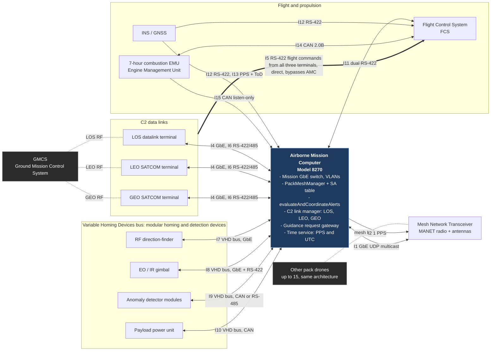

# Deliverable 3 — Drone hardware block diagram with mesh integration

The Airborne Mission Computer Model 8270 (AMC) is the hub. It joins three things: the **Mesh Network Transceiver** that links the pack, the **Variable Homing Devices bus** that carries the payload's homing and detection devices, and the flight side, where the **7-hour combustion EMU** gives the fuel figures that decide which drones can be diverted. This is a **recommended architecture**: the interface list is what the software in this repo assumes, not a confirmed Model 8270 ICD. Check every row against the real interface control document.

Three design rules shape the diagram:

1. **The operator's path to the aircraft does not go through the mesh.** The C2 terminals reach the FCS directly; the AMC only sees mission data. A hung or hostile mesh cannot block flight commands.
2. **The AMC only asks; the FCS decides.** Verification tasks arrive at the FCS as requests. The FCS enforces the approved corridor and may refuse or revert at any time.
3. **One time base.** 1 PPS and time-of-day from the INS/GNSS discipline the AMC clock, which stamps every mesh message and observation.

---

## 1. Mermaid diagram



---

## 2. ASCII hardware block diagram

```
                               +------------------------------------------------+
                               |      GROUND MISSION CONTROL SYSTEM (GMCS)      |
                               +------------------------------------------------+
                                        :               :               :
                                        : LOS RF        : LEO RF        : GEO RF
                                        v               v               v
+--------------------------------------------------------------------------------------------------------------+
|       C2 DATA LINKS    [ LOS datalink terminal ]    [ LEO SATCOM terminal ]    [ GEO SATCOM terminal ]       |
+--------------------------------------------------------------------------------------------------------------+
                                        ^                     ^                                      |
                   I4 GbE: mission data |       I6 RS-422 M&C |       I5 RS-422: flight cmds, direct |
                                        |                     |                   (bypasses the AMC) |
                                        v                     v                                      v
                          +--------------------------------------------------------+          +--------------+
                          |         AIRBORNE MISSION COMPUTER  MODEL 8270          |          |    FLIGHT    |
+--------------+          | +--------------------+      +------------------------+ |          |   CONTROL    |
|     MESH     |          | | MISSION GbE SWITCH |      |    PackMeshManager     | |          | SYSTEM (FCS) |
|   NETWORK    |<---I1--->| | VLAN: mesh / C2 /  |<---->|    peer discovery,     | |          |              |
| TRANSCEIVER  |          | |      sensors       |      |  state sync, SA table  | |<--I11--->| enforces the |
|(MANET radio) |<---I2----| +--------------------+      +------------------------+ |          |corridor; may |
|              |          |                                         ^              |          |  refuse AMC  |
|              |          |                                         v              |          |   requests   |
+--------------+          | +--------------------+      +------------------------+ |          +--------------+
       :                  | |  C2 LINK MANAGER   |      | evaluateAndCoordinate  | |                 ^
       : mesh RF          | |  LOS > LEO > GEO   |<---->|  Alerts: fuse, rank,   | |                 | I12
       ^                  | |   (ports I4, I6)   |      |    nominate, alert     | |          +--------------+
+--------------+          | +--------------------+      +------------------------+ |<--I12/13-|  INS / GNSS  |
|  other pack  |          |                                         ^              |          | nav solution |
|    drones    |          |                                         v              |          +--------------+
+--------------+          | +--------------------+      +------------------------+ |
                          | |    TIME SERVICE    |      |    GUIDANCE REQUEST    | |          +--------------+
                          | |    1 PPS + UTC     |      |        GATEWAY         | |          |    7-HOUR    |
                          | | stamps all traffic |      |   corridor pre-check   | |          |  COMBUSTION  |
                          | +--------------------+      +------------------------+ |<--I15----|     EMU      |
                          |                                                        |          | (engine mgmt)|
                          | Fixed storage, no heap, bounded loops                  |          | I14: CAN-FCS |
                          |                                                        |          +--------------+
                          +--------------------------------------------------------+
                                    ^                 ^                 ^
                                    | I7 GbE: RF-DF   | I8 GbE+RS-422   | I9/I10 CAN/485
                                    v                 v                 v
                          +--------------------------------------------------------+
                          |              VARIABLE HOMING DEVICES BUS               |
                          |          modular homing and detection devices          |
                          |  [RF-DF] [EO/IR gimbal] [Anomaly det.] [Payload pwr]   |
                          +--------------------------------------------------------+
```

Reading the diagram: `I1`..`I16` are the interface IDs of the table in section 3. `<--->` is a bidirectional link, `:` is a radio link. The C2 terminals reach the FCS directly (`I5`); the AMC never sits in the flight-command path. `I12` (INS/GNSS) feeds both the FCS and the AMC; `I14` (7-hour combustion EMU to FCS over CAN) is noted in the EMU box rather than drawn. `I7` to `I10` together are the Variable Homing Devices bus.

---

## 3. Interface table

I7 to I10 together form the **Variable Homing Devices bus**: the payload interface through which the modular homing and detection devices (RF direction-finder, EO/IR gimbal, anomaly detectors) and their power unit attach to the AMC. A device added to or removed from the bus changes `installed_sensors` and therefore which tasks the pack gives that drone.

| ID | Link | Bus | Rate (recommended) | Content | Notes |
|---|---|---|---|---|---|
| I1 | Mesh Network Transceiver ↔ AMC | Gigabit Ethernet, UDP multicast | Offered load 2–4 kbit/s per drone (simulated); radio capacity ≥ 1 Mbit/s shared | `MeshPacket` frames, ≤ 160 B | Own VLAN. The software caps frames at 160 B |
| I2 | AMC time service → Mesh Network Transceiver | 1 PPS, RS-422 differential | 1 Hz | Time pulse for the radio's slot timing | Optional if the radio is CSMA-based |
| I3 | Mesh Network Transceiver management | RS-422 or Ethernet management | 38.4–115.2 kbaud | Frequency, power, link statistics, emergency key zeroize | |
| I4 | LOS, LEO, GEO terminals ↔ AMC | Gigabit Ethernet | ≥ 10 Mbit/s each, 1 Gbit/s ports | Alerts, mission data, downlinked imagery | One VLAN per terminal |
| I5 | C2 terminals → FCS | RS-422, dual | 115.2–460.8 kbaud | **Flight commands, direct, not via AMC** | Rule 1 above |
| I6 | AMC ↔ C2 terminals (M&C) | RS-422 / RS-485 | 38.4–115.2 kbaud | Link state, antenna control, selecting the active link | Feeds `available_links` in `DroneState` |
| I7 | Variable Homing Devices bus: RF direction-finder ↔ AMC | Gigabit Ethernet | ~1–10 Mbit/s | Bearing reports (VITA-49 style context packets); IQ on demand | Reports are what the mesh needs |
| I8 | Variable Homing Devices bus: EO/IR gimbal ↔ AMC | Gigabit Ethernet (video, fixes); RS-422 (control) | 5–25 Mbit/s video; 115.2 kbaud control | H.265 video, geolocated target fixes, cueing | The mesh uses the fixes, not the video |
| I9 | Variable Homing Devices bus: anomaly detectors ↔ AMC | CAN 2.0B or RS-485 | 500 kbit/s CAN, up to 1 Mbit/s RS-485 | Events, status | Low-rate modules |
| I10 | Variable Homing Devices bus: payload power unit ↔ AMC | CAN 2.0B | 500 kbit/s | Per-payload power state and fault reports; power on/off commands | 28 VDC payload bus |
| I11 | AMC ↔ FCS | RS-422, dual redundant (MIL-STD-1553B if the airframe requires it) | 460.8 kbaud, 10 Hz state, event-driven requests | **AMC → FCS:** verification request (standoff point, approach bearing, sensor to cue), cancel. **FCS → AMC:** mode, corridor, accept / refuse, health | The FCS keeps authority |
| I12 | INS/GNSS → AMC and FCS | RS-422 | 115.2–921.6 kbaud, 100–200 Hz | Position, velocity, attitude | AMC copy feeds `DroneState.position` |
| I13 | INS/GNSS → AMC time service | 1 PPS + time of day (IRIG-B or NMEA) | 1 Hz | UTC time base | Stamps all mesh messages |
| I14 | 7-hour combustion EMU ↔ FCS | CAN 2.0B / CANaerospace | 500 kbit/s, 10–50 Hz | Engine control and status | Flight-critical |
| I15 | 7-hour combustion EMU → AMC | CAN 2.0B, listen-only | 5–10 Hz | Fuel flow, fuel quantity, engine state | Gives `endurance_remaining_s` against the 25,200 s nominal |
| I16 | Power | 28 VDC | | Separate feeds for AMC, mesh radio, C2 terminals, payloads | Brown-out of payloads must not reset the AMC |

## 4. How the 8270 computes what it shares

| `DroneState` field | Source |
|---|---|
| `position`, `speed_mps`, `heading_deg` | INS/GNSS (I12) |
| `mode` | GMCS command through the C2 link manager (I6); the mesh reports `VERIFYING` itself |
| `endurance_remaining_s` | 7-hour combustion EMU: fuel quantity ÷ smoothed fuel flow (I15), against the 7 h nominal |
| `bingo_endurance_s` | Time to reach the recovery point at current wind, from the FCS (I11) |
| `active_sensor`, `installed_sensors` | Variable Homing Devices bus (I7–I10) |
| `available_links` | C2 link manager (I6) |

## 5. Failure containment

- **AMC or mesh hangs:** the FCS sees no AMC heartbeat on I11 within its timeout and reverts to the planned route. Flight commands (I5) are unaffected.
- **Mesh jammed or out of range:** each drone keeps working from its own table; the pack degrades to independent drones, which is today's baseline.
- **C2 link lost:** alerts queue and go out on whichever link comes back; any drone with a link can send them.
- **Homing device brown-out:** a device on the Variable Homing Devices bus that loses power is dropped from `installed_sensors`; the drone stays in the pack and keeps sharing what its other devices see.
- **Bad FCS state data:** the AMC refuses to nominate a drone whose `DroneState` fails validation (range, finiteness).
